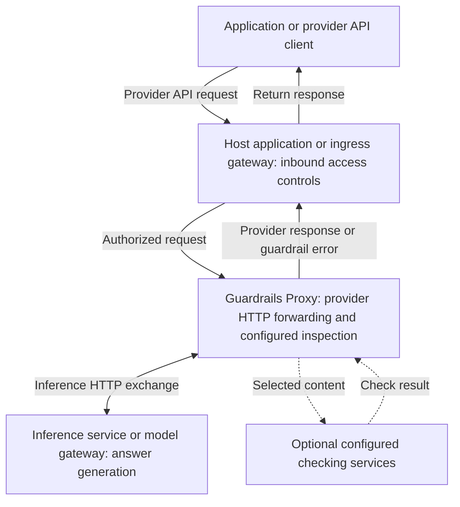
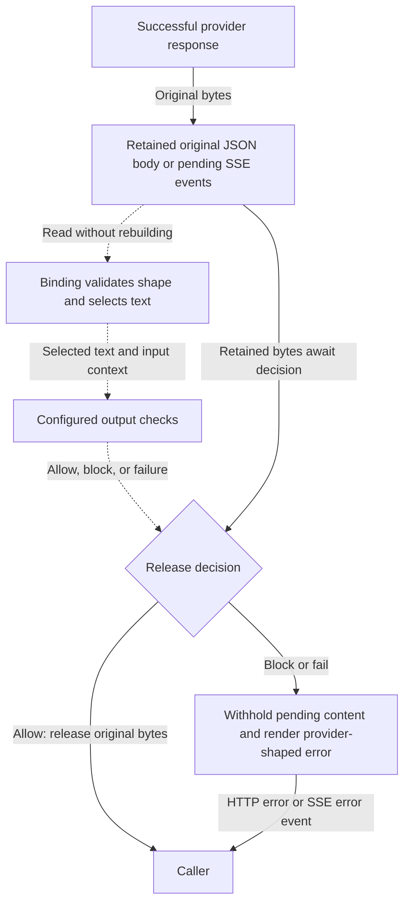

Guardrails Proxy adds content inspection around an existing provider HTTP
exchange. Provider bindings define the inspection coverage, the NVIDIA NeMo
Guardrails library runs configured checks, and the upstream service generates
the answer. The proxy preserves accepted provider JSON bodies and server-sent
events (SSE) while applying its HTTP path and header forwarding rules.

## Choose a reading path

| You are | Read |
| --- | --- |
| Using the proxy in an application | Start with [system context](#system-context) and [inspection and forwarding](#inspection-and-forwarding), then follow the [request lifecycle](architecture-requests.mdx). |
| Extending the framework | Read [framework internals](architecture-internals.mdx) for dependency boundaries, policy selection, state ownership, and implementation/test locations. |
| Operating or embedding a deployment | Read [operating the proxy](#operating-the-proxy), then use the [configuration](configuration.mdx), [deployment](deployment.mdx), and [Python integration](python-integration.mdx) guides. |

## System context

This view shows the proxy as one software system and its external interactions.
Solid arrows describe provider traffic; dotted arrows describe optional
checking-service calls. Access controls belong to your application or gateway.

The access-controls box represents a responsibility, not a required extra
process. It can run in an embedding application's middleware or an inbound
gateway. The launcher binds loopback by default and does not authenticate callers.
Checking-service calls serve a separate role from answer generation; the same
backend can serve both roles. External services are needed only when your Rails
checks use them.

The proxy is the `guardrails-proxy` distribution and `guardrails_proxy` Python
package, with source under `guardrails-server/` in this checkout. It embeds the
NVIDIA NeMo Guardrails library in its process. The library's existing API server
remains a separate application. YAML and Python entry points assemble the same
proxy factory and lifespan; see [application assembly](architecture-internals.mdx#application-assembly).

## Inspection and forwarding

Inspection uses a selected view of the payload. The proxy retains the original
body or event bytes alongside that view and uses check decisions to control
their release. It does not serialize an accepted response from a validation
model.

This diagram shows a successful upstream response containing guarded text, with
output inspection enabled. Solid arrows carry original bytes or the response
chosen for the caller. Dotted arrows carry projected content or check decisions.

Invalid inspected representations are rejected before release. Reviewed
successful responses without guarded text and upstream HTTP errors have
operation-specific handling; follow [buffered requests](architecture-requests.mdx#buffered-requests)
for those branches. Streaming releases approved windows in order and cannot
retract earlier output.

Coverage and enabled checks are independent. This forwarding table makes the
uninspected paths explicit:

| Traffic | Request handling | Response handling |
| --- | --- | --- |
| Guarded operation with checks enabled | Validate the bound shape; run enabled input checks before dispatch. | Apply enabled output checks to declared content; release accepted original bytes. |
| Guarded operation with output checks disabled | Guarded request validation and any enabled input checks still apply. | Relay response bytes without output projections or SSE classification. |
| Unselected operation handled by pass-through | Forward under the provider's HTTP routing/header rules, without content inspection. | Forward without content inspection. |
| Unsupported content on a guarded operation | Reject unsupported request content before dispatch. | With output inspection enabled, withhold unsupported successful response content. No fallback to pass-through. |

Bindings currently use `single_text.v1` and `single_text_delta.v1` capabilities.
An operation name does not imply inspection of its entire upstream API. Consult
[providers and streaming](providers-and-streaming.mdx) for the shipped content
restrictions and [guard contracts](guard-contracts.mdx) for field-level coverage.

## Design decisions and tradeoffs

These are current implementation choices and their observable consequences.

| Choice | Effect | Tradeoff |
| --- | --- | --- |
| Inspect projections while retaining original bytes. | Accepted provider bodies/events keep their representation and metadata. | Current integrations reject replacement outcomes; opaque fields remain uninspected. |
| Separate provider bindings, execution, and Rails checks. | The same checking pipeline serves reviewed operations and dialects. | New content capabilities need matching projection, execution, checker, and test support. A new profile name alone adds no capability. |
| Derive guard-contract exports from typed declarations. | Review artifacts describe the bound coverage from one authoritative source. | Editing exported YAML changes no runtime policy; stateful hooks and arbitrary Python behavior need separate review. |
| Preload every registered Rails configuration before readiness. | Requests select ready checkers without loading files or constructing engines. | Startup time and resources grow with the catalog, including unused entries. Initialization failure prevents readiness. |
| Check streaming windows before release. | Output can arrive incrementally after checks approve each window. | Smaller windows increase check frequency; short responses can wait until completion. Finite context and irreversible release limit whole-answer guarantees. |

See [framework internals](architecture-internals.mdx) for the interfaces enforcing
these boundaries and [streaming inspection](architecture-requests.mdx#streaming-inspection)
for a concrete window example.

## Operating the proxy

Construction, startup, request handling, and shutdown have different owners:

| Phase | What happens |
| --- | --- |
| Application construction | Validate declarations, configuration paths, and route composition. No upstream calls or Rails initialization. |
| Lifespan startup | Create the shared HTTP client/transport and initialize every declared Rails configuration before readiness. |
| Request handling | Select a ready checker; create request-local stream hooks/adapters and acquire upstream response resources as needed. |
| Failed startup or shutdown | Attempt checker cleanup and HTTP cleanup independently with bounded, shielded cooperative budgets. |

Timeouts do not establish that uncooperative owners released all resources.
Embedding applications must explicitly enter the proxy lifespan; mounting alone
does not initialize it. Follow [lifespan and embedding](python-integration.mdx#lifespan-and-embedding)
and retain the [compatibility validation](../DEVELOPMENT.md#compatibility-and-lifecycle-validation)
requirements.

Destination routing, replication, and placement are separate dimensions that
can be combined:

| Decision | Choices and consequences |
| --- | --- |
| Destination routing | Use a fixed upstream, an inference gateway, distinct provider mounts, or a trusted application transport. The selected upstream must match the bound operation/dialect. |
| Replication | Equivalent replicas each own independent client pools and Rails engines. An established stream stays with its handling replica. Replicas can front either a fixed upstream or a gateway. |
| Placement | Run a standalone service, local companion, or embedded ASGI application. Embedding transfers lifespan coordination to the host application. |
| Access and credentials | Your application/gateway owns inbound authentication and authorization. Destination-aware routing must apply credentials appropriate to the destination. |

Several provider mounts in one process share its HTTP client/transport and do
not provide process isolation. The [deployment guide](deployment.mdx) supplies
topologies and routing examples; [configuration](configuration.mdx) covers
selection and limits without duplicating those deployment instructions here.
